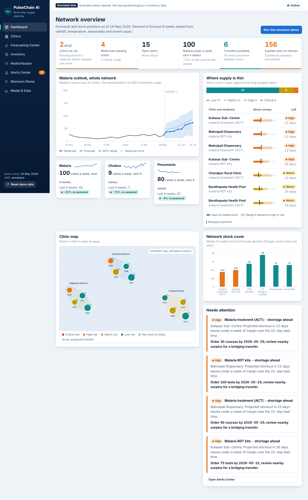
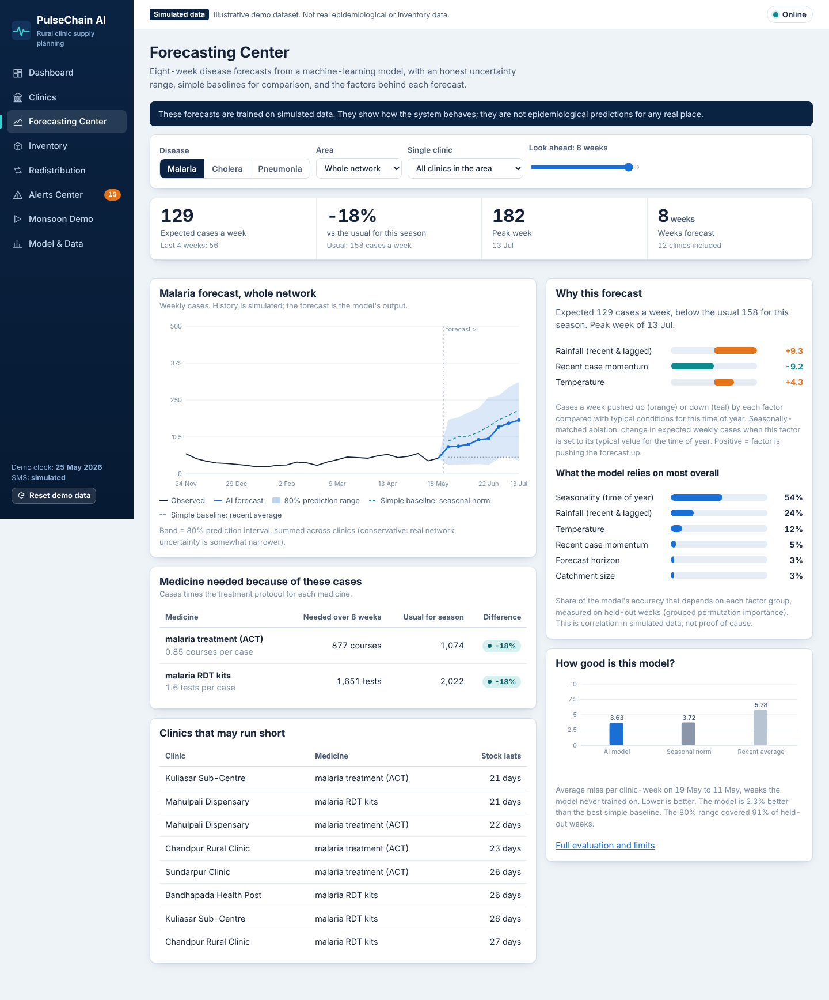
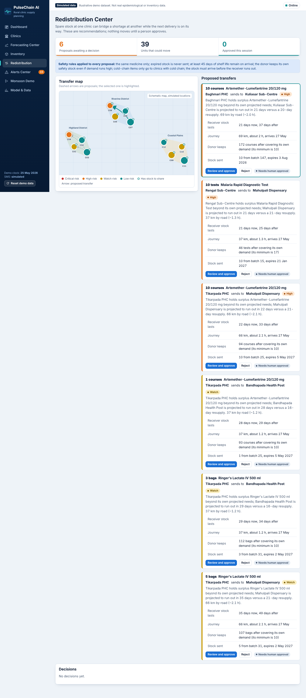
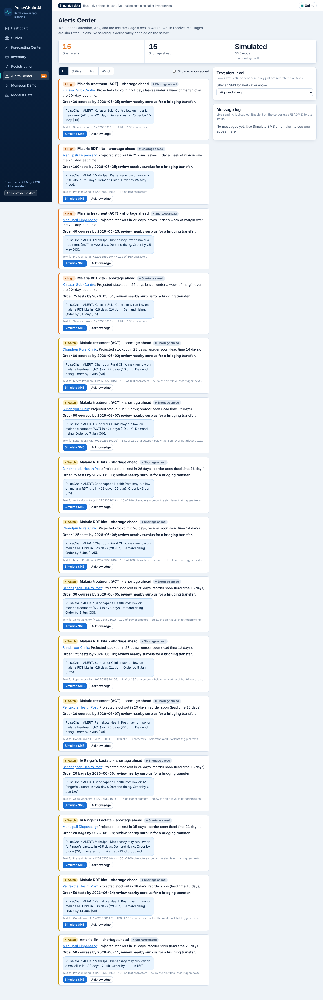
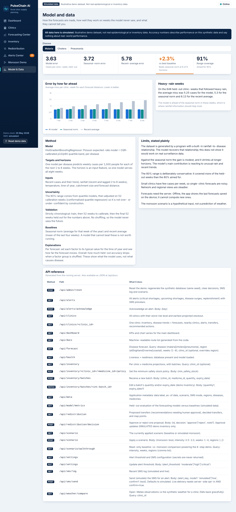
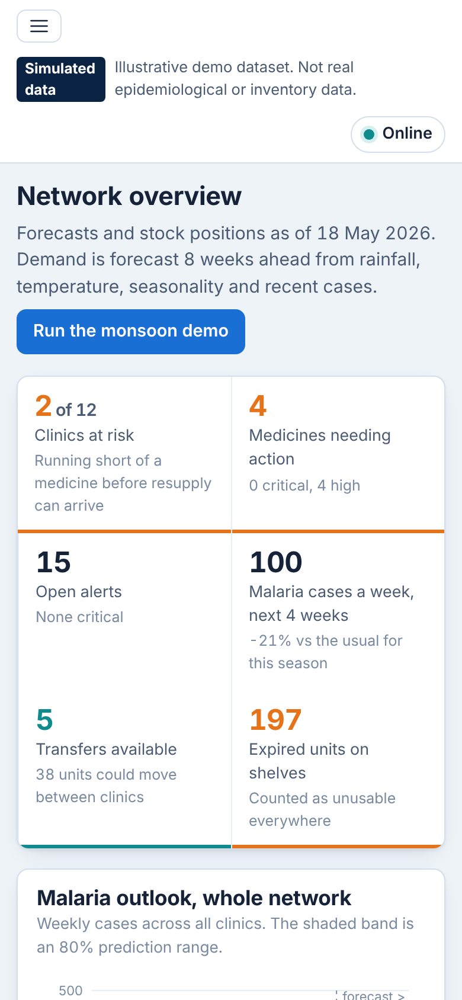
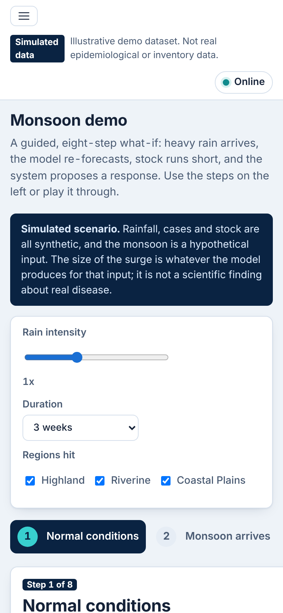

# PulseChain AI

**Forecast disease demand, predict medicine stockouts, and coordinate village-to-village redistribution for rural clinics, in a web app that keeps working when the signal drops.**

> **All data in this project is simulated.** The clinics, cases, weather, stock levels and phone numbers are produced by a seeded generator. Nothing here is real epidemiology or real inventory, every screen says so, and the accuracy figures below describe performance on that synthetic data only. The monsoon "surge" is a what-if input, not a scientific claim.



## Contents
1. [The problem](#the-problem) · 2. [What PulseChain does](#what-pulsechain-does) · 3. [Architecture](#architecture) · 4. [Features](#features) · 5. [Tech stack and substitutions](#tech-stack-and-substitutions) · 6. [Install and run](#install-and-run) · 7. [Dataset](#dataset) · 8. [ML methodology and results](#ml-methodology-and-results) · 9. [Inventory, SMS and redistribution logic](#inventory-sms-and-redistribution-logic) · 10. [Offline (PWA)](#offline-pwa) · 11. [Monsoon demo](#monsoon-demo) · 12. [API](#api) · 13. [Tests](#tests) · 14. [Screenshots](#screenshots) · 15. [Limitations](#limitations) · 16. [Future improvements](#future-improvements)

## The problem
Rural clinics reorder medicine on habit or a fixed schedule. When the rains come, malaria, cholera and pneumonia cases climb a few weeks later and stock that looked ample at normal use runs out before the next delivery, which can take two to three weeks over bad roads. A neighbouring clinic often has spare, unexpired stock it will not need, but nobody can see it, and a health worker in a low-signal area is rarely told early enough.

## What PulseChain does
1. **Forecasts** weekly cases of each disease 4 to 8 weeks ahead from rainfall, temperature, season and recent cases, with an uncertainty range, simple baselines for comparison, and the factors behind each forecast.
2. **Predicts stockouts** per clinic and medicine: usable stock, expected use, days until it runs out (with high and low demand cases), when to reorder and how much.
3. **Alerts** health workers by SMS (simulated by default) with a short, specific message.
4. **Recommends transfers** of spare stock between clinics under explicit safety rules. A person approves every one.
5. **Works offline** as an installable PWA: cached dashboards, an offline indicator, and a queue for low-risk edits that syncs on reconnect.

## Architecture
```
 Browser (installable PWA, no build step)                     Server (Flask)
┌──────────────────────────────────────────┐   HTTPS/JSON   ┌───────────────────────────────────────┐
│ Pages: Dashboard, Clinics, Forecasting,  │ ─────────────► │ api/app.py  REST + static + SW hash   │
│ Inventory, Redistribution, Alerts,       │ ◄───────────── │   │                                   │
│ Monsoon Demo, Model & Data               │                │ services/platform.py  orchestration   │
│ lib/api.js   offline-aware client+queue  │                │   ├─ inventory.py     projection+FEFO │
│ lib/charts.js, lib/map.js  SVG, no libs  │                │   ├─ redistribution.py  safe transfers│
│                                          │                │   ├─ alerts.py / sms.py  (Twilio opt.)│
│ Service worker                           │                │   ├─ scenario.py   monsoon overlay    │
│  • precache app shell                    │                │   └─ weather.py    Open-Meteo (opt.)  │
│  • network-first /api, cached fallback   │                │ ml/  features, train, inference       │
│ localStorage write queue → replay        │                │ db.py  SQLite (stdlib, PG-ready)      │
└──────────────────────────────────────────┘                └───────────────────────────────────────┘
```
The service layer talks to plain dicts and DataFrames, so the SQLite layer (`db.py`) can be swapped for PostgreSQL without touching the engines.

## Features
| Area | What you get |
|---|---|
| **Dashboard** | Clinics at risk, medicines needing action, open alerts, network malaria outlook with 80% band, stock-runway list, disease cards, clinic map, network stock cover, top alerts |
| **Clinics** | Searchable, filterable list; per-clinic page with stock runways, per-disease forecast, suggested actions and nearby clinics with spare stock |
| **Forecasting Center** | Disease, region, single clinic, 4 to 8 weeks; forecast with band; seasonal-norm and recent-average baselines; per-forecast driver breakdown; global importance; medicine demand; held-out accuracy vs baselines |
| **Inventory** | Edit batch quantity and expiry, receive stock, set safety stock. Every projection, alert and transfer recalculates. Expired stock is never counted |
| **Redistribution Center** | Schematic map with transfer arrows, rationale, journey, donor safety margin, batch expiry, **Review and approve** or **Reject** with confirmation |
| **Alerts Center** | Critical shortages, shortages ahead, disease surges, resupply due; SMS preview; **Simulate SMS**; acknowledge; alert-level setting; message log |
| **Monsoon demo** | Eight guided steps, adjustable intensity, duration and regions, "play through", apply to the live app, return to normal |
| **Model & Data** | Method, accuracy by horizon, heavy-rain performance, limits, API reference |

## Tech stack and substitutions
The brief suggested React, Tailwind, Recharts, Leaflet, XGBoost or Prophet, and a PostgreSQL-class database. The build environment could not install packages, so I chose dependency-light equivalents and kept the design portable. These are deliberate, not oversights:

| Suggested | Used | Why / consequence |
|---|---|---|
| React + Tailwind | Vanilla ES modules + one CSS file with design tokens | No build step; the app is just static files served by Flask and precached by the service worker |
| Recharts | Hand-built SVG charts (`lib/charts.js`) | No dependency; fully offline; tooltips and keyboard-friendly labels included |
| Leaflet / map tiles | Offline schematic SVG map (`lib/map.js`) | Tiles cannot load offline. Clinics sit at their simulated coordinates on a distance-preserving projection |
| XGBoost / Prophet | scikit-learn `HistGradientBoostingRegressor` | Same family as XGBoost (gradient-boosted trees); Poisson and quantile losses are built in |
| PostgreSQL / Supabase | SQLite via the standard library | Zero setup. All SQL is isolated in `db.py` |

Backend: Python 3.11+, Flask, NumPy, pandas, scikit-learn, joblib, requests. Tests: pytest. Browser checks (optional): Playwright.

## Install and run
Requires Python 3.11+.
```bash
git clone https://github.com/mithunkanakaraj12-beep/pulse_chain.git
cd pulse_chain
python -m venv .venv && source .venv/bin/activate     # Windows: .venv\Scripts\activate
pip install -r requirements.txt

# generate the synthetic dataset and train the models (about 20 to 40 seconds)
python -m pulsechain.cli reset --train        # run from ./backend  (or: npm run reset-demo)
python -m pulsechain.cli serve                # run from ./backend  (or: npm run start)
```
Open <http://127.0.0.1:8000>. If you start the server without data or a model it creates and trains them first.

Useful commands (run from `backend/`): `python -m pulsechain.cli status`, `... train`, `... reset --seed 7`. **Reset demo data** is also a button in the app and `POST /api/admin/reset`.

Configuration lives in `.env` (copy `.env.example`; nothing is required). **Never commit `.env`.**

| Variable | Default | Meaning |
|---|---|---|
| `ALERT_RISK_THRESHOLD` | `high` | Risk at or above which an SMS is offered |
| `SMS_MODE` | `simulated` | `simulated` or `live` |
| `SMS_ALLOW_LIVE` | `false` | Second lock: live sending is refused unless `true` |
| `TWILIO_ACCOUNT_SID`, `TWILIO_AUTH_TOKEN`, `TWILIO_FROM_NUMBER` | empty | Needed only for live SMS |
| `OPEN_METEO_ENABLED` | `false` | Compare synthetic weather with Open-Meteo observations; falls back gracefully |

### Installing as an app and testing offline
Service workers need `localhost` or HTTPS. In Chrome or Edge on the running app use *Install app*. To see offline behaviour: open a few pages, then DevTools, Network, Offline (or stop the server) and reload.

## Dataset
Generated by `backend/pulsechain/data_gen.py`, seeded (default 42) so every run is identical.
* **12 clinics** in three regions (highland, riverine, coastal) with catchment populations, resupply lead times, road speeds and fictional health workers (`+1 202 555 01xx`).
* **260 weeks** of weather (rainfall, temperature) and cases of **malaria, cholera, pneumonia** per clinic: 3,120 weather rows and 9,360 case rows.
* **Six medicines** (ACT, malaria RDT, ORS, Ringer's lactate, doxycycline, amoxicillin) with 18,720 weekly consumption rows derived from cases through treatment protocols (units per case), plus noise.
* **148 stock batches** with expiry dates, including deliberate cases: expired stock, short-dated stock, and a clinic with spare stock to share.
* Built-in mechanisms the model can learn: malaria follows rain with a lag of about 2 to 6 weeks, cholera responds to heavy rain, pneumonia follows temperature and season. The tests confirm these relationships exist.

Demo clock: last observed week starts 2026-05-18; "today" in the app is 2026-05-25, so results do not drift with the real calendar.

## ML methodology and results
* **Pooled direct multi-horizon model per disease.** One model predicts cases per 1,000 people for horizons 1 to 8 weeks; the horizon is a feature. No recursive forecasting, so errors do not compound.
* **Features:** recent cases (lags 1 to 3, 4 and 8-week means), rainfall (this week, 2/4/8-week averages, 4-week maximum, and a 4-week-lagged average), temperature, seasonality (week of year as sine and cosine), catchment size, horizon.
* **Models:** `HistGradientBoostingRegressor` with Poisson loss for the expected value, plus p10 and p90 quantile models on `log1p(rate)` for the band.
* **Uncertainty:** the band is calibrated with conformalised quantile regression on 52 held-out calibration weeks, so its width reflects measured error.
* **Validation:** strictly chronological train / calibration (52 weeks) / test (52 weeks), with an 8-week purge before each boundary so no training target overlaps a later window. No shuffling.
* **Baselines:** persistence (mean of the last 4 weeks) and seasonal climatology (average for that week of year).
* **Explanations:** per forecast, set each factor group to its seasonal-typical value and measure the change (an ablation, not SHAP; groups interact, so parts need not sum exactly). Globally, grouped permutation importance on the held-out weeks. These show what the model relies on, **not causes**.

Held-out results (52 weeks, all clinics, **simulated data**), average miss in cases per clinic-week:

| Disease | Model | Seasonal norm | Recent avg | Gain vs best baseline | 80% band actually covered | Beats seasonal norm at horizons |
|---|---|---|---|---|---|---|
| Malaria | 3.63 | 3.72 | 5.78 | 2.3% | 91% | 6 of 8 |
| Cholera | 2.37 | 2.69 | 3.49 | 11.9% | 93% | 8 of 8 |
| Pneumonia | 4.75 | 4.93 | 5.62 | 3.7% | 87% | 8 of 8 |

**Read these honestly.** The gain over the seasonal norm is modest, especially for malaria. In the heavy-rain subset (648 clinic-weeks) the model is slightly ahead for malaria (5.25 vs 5.30) and pneumonia (4.80 vs 4.96) but **behind the seasonal norm for cholera** (5.79 vs 5.42). The band is conservative (it covers more than the 80% aimed for). Because the data are generated from simple rules, these numbers say nothing about real-world accuracy.

## Inventory, SMS and redistribution logic
**Inventory projection** (`services/inventory.py`) is transparent and unit-tested:
* Usable stock excludes anything on or after its expiry date. Consumption is first-expired-first-out.
* Daily demand comes from the weekly disease forecast times the treatment protocol, beyond the 8-week horizon extrapolated and flagged.
* Days to stockout is computed for central, high-demand (pessimistic) and low-demand (optimistic) cases.
* Safety stock is the larger of the clinic's policy and the extra demand a high-demand case adds over the lead time. Reorder quantity covers demand over the lead time plus a review window, plus safety stock, minus stock that can actually be consumed, rounded up to the medicine's order multiple. Reorder date is the stockout date minus the lead time (today if already late).
* Risk is relative to resupply time: **critical** if stock ends within the lead time, **high** within lead + 7 days, **watch** within lead + 21 days, otherwise low.

**SMS** (`services/sms.py`): one segment (160 ASCII characters), naming the clinic, medicine, days left, demand direction, and the order to place. **Simulated by default**: messages go to a log and nothing is sent. Real sending needs `SMS_MODE=live` **and** `SMS_ALLOW_LIVE=true` **and** all Twilio credentials **and** a confirmation on each send. Otherwise the API returns 403. Nothing is ever sent automatically.

**Redistribution** (`services/redistribution.py`) proposes a transfer only when all of these hold:
same medicine; cold-chain items only to clinics with cold chain; batch unexpired with at least 45 days of shelf life on arrival; the donor still keeps its minimum safety stock under high demand over the lead time plus 14 days; distance at most 150 km and travel at most 8 hours; arrival before the receiver would run out; the receiver gets only its bridging gap. Every proposal carries `requires_human_approval`. Approving updates **simulated** inventory only.

## Offline (PWA)
* **Service worker** (`frontend/sw.js`): precaches the app shell using a content-hash manifest (`/asset-manifest.json`) so installed copies update when files change; serves `/api` GETs network-first and falls back to the last saved response, tagged `X-PulseChain-Cache: offline`.
* **Indicator:** the top bar shows Online or Offline, and a banner explains what works.
* **Edit queue:** while offline, inventory edits, new batches, safety-stock changes, alert acknowledgements, transfer decisions and the alert threshold are saved in `localStorage` and replayed in order on reconnect. The server revalidates each one; stale or invalid ones are dropped and reported, not silently applied.
* **What does not work offline, by design:** computing new forecasts, changing the monsoon scenario, simulating SMS, and resetting data all need the server and say so. Offline forecasts are the last ones saved on the device.
* The end-to-end script proves this in a real browser (cached dashboard offline, queued edit, sync on reconnect, edit visible on the server).

## Monsoon demo
Open **Monsoon Demo** and use *Next* or *Play through*:
1. **Normal conditions**: baseline map, malaria level, risk mix.
2. **Monsoon arrives**: weekly rain, normal vs simulated, per region.
3. **AI forecast**: cholera and malaria forecast with and without the monsoon.
4. **Medicine demand**: eight-week need per medicine, before and after.
5. **Shortages detected**: stock runways, ratings before and after, and what a naive stock/average-use count would have said.
6. **Alerts by SMS**: the messages a health worker would receive (preview only).
7. **Redistribution**: safe transfer proposals on the map.
8. **Result**: pairs at risk before, with the monsoon, and after transfers; **Apply this monsoon to the live dashboard** to explore every page under the scenario, then **Return to normal**.

Intensity, duration and affected regions are adjustable. The walkthrough endpoint is read-only: it never changes data or sends anything. **Every figure is computed from the model on a simulated rainfall overlay.** With the default settings (1x, 3 weeks, all regions) the model gives roughly **+49% malaria** and **+547% cholera** over eight weeks, and pairs at risk rise from 4 to 25; at 2x malaria is about +52%. Cholera starts from a very low baseline, so its percentage is large. A 300% malaria spike was **not** reproduced by this model and is not shown: nothing in the UI is hard-coded, and the disclaimer "NOT a scientifically established prediction" is on screen throughout.

## API
`GET /api/docs` lists every route from the running code. Main routes:

| Route | Purpose |
|---|---|
| `GET /api/health`, `/api/meta` | Readiness; app metadata and data label |
| `GET /api/dashboard`, `/api/clinics`, `/api/clinics/<id>` | Views |
| `GET /api/forecast?disease=&region=&clinic_id=&weeks=` | Forecast with band, baselines, drivers, demand |
| `GET /api/model/metrics` | Held-out evaluation |
| `GET /api/inventory`, `PATCH /api/inventory/batches/<id>`, `POST /api/inventory/batches`, `PUT /api/inventory/<clinic>/<medicine>/policy` | Inventory read and edits |
| `GET /api/redistribution`, `POST /api/redistribution/decision` | Proposals; approve or reject |
| `GET /api/alerts`, `POST /api/alerts/acknowledge` | Alerts |
| `POST /api/sms/send`, `GET /api/sms/log` | SMS (simulated by default) |
| `GET/PUT /api/settings` | Alert threshold; SMS configuration (secrets never returned) |
| `GET/POST /api/scenario`, `GET /api/scenario/walkthrough` | Monsoon scenario; read-only walkthrough |
| `POST /api/admin/reset` | Regenerate demo data |

Errors are JSON `{"error": {"code", "message"}}` with proper status codes (400 validation, 404, 409 conflict, 403 live SMS not enabled, 503 model not ready).

## Tests
```bash
cd backend && python -m pytest -q        # 112 tests, about 100 s (trains the model once)
pip install playwright pillow && playwright install chromium   # one-time, for the browser check
python scripts/e2e_check.py              # 36 browser checks on a throw-away server; refreshes docs/screenshots
python scripts/make_icons.py             # regenerates the PWA icons
```
Coverage: data scale and reproducibility, planted rainfall-to-malaria relationship, model beats baselines and interval coverage, forecast shape and determinism, inventory arithmetic (FEFO, expiry, safety stock, rounding), redistribution safety rules (including never sending expired stock and never leaving the donor short), SMS length and the live-send locks, API contract and validation, scenario never mutating stored data, and safety invariants at monsoon intensities 0.5, 1 and 2. The e2e script covers every page, edits, approvals, SMS, the demo, offline queue and sync, and the mobile layout.

## Screenshots
| | |
|---|---|
|  |  |
|  |  |
|  |  |

## Limitations
* Simulated data only; no real-world validity is claimed. Do not use for clinical or procurement decisions.
* No authentication or multi-user roles: it is a single-tenant demo. Put it behind real auth before any real use.
* The map is schematic (no tiles). Road distances are straight-line estimates scaled by clinic road speed.
* The service worker needs HTTPS or localhost. Cached data is only as fresh as the last online visit.
* Modest forecasting gain over seasonal norms; weak for cholera in heavy-rain weeks (see above).
* Live SMS was written against the Twilio API and covered by tests with a mocked client; it has **not** been exercised against a real Twilio account.
* Open-Meteo comparison is optional and unverified against live responses in this environment (tested with mocked responses).

## Future improvements
Real surveillance and stock-system integrations (DHIS2, LMIS), authentication and audit trails, PostgreSQL, vector map tiles cached for offline, road-network routing, USSD or WhatsApp channels, per-clinic hierarchical models, proper probabilistic evaluation (CRPS, pinball loss), background sync via the Background Sync API, and a clinician review loop to learn from rejected transfers.

## Repository layout
```
backend/pulsechain/   api/  services/  ml/  config.py  db.py  data_gen.py  domain.py  cli.py
backend/tests/        pytest suite
frontend/             index.html  sw.js  manifest  css/  js/lib/  js/pages/  icons/
scripts/              e2e_check.py  make_icons.py
docs/screenshots/     images referenced above
data/                 generated database and models (git-ignored)
```
Branches: `main` is the stable line; features were developed on `chore/scaffold`, `feat/ml-forecasting` and `feat/frontend` and merged.

## License
MIT
